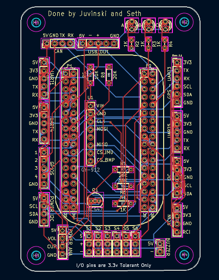

# PocketBeagle 2 DIY Cape for Ardupilot
This project has an aim to run [Ardupilot](https://ardupilot.org/) on the [PocketBeagle 2](https://www.beagleboard.org/boards/pocketbeagle-2) Board.

# Board manufacturing
## PCBWay
I'm using the PCBWay company online to produce the boards - Five boards have a cost of USD $25.00 or around that
amount (things change with time)...

You can use [this file](Board_Archives_Manufacturing/Pocket2.kicad_pcb.zip).

## Other Services
I believe the same file can be used by other online, PCB manufactures.

# Testing
## Finding what is wrong with the .dtbo and .dtb can be trying
### Can this Cape work? I am going throughout the motions now!
There is an extlinux.conf file. In that file, one needs to place specific files in it. Files like a
`.dtb` and `.dtbo` are needed to make sure the IMU is up and running via `/dev/spidev0.0` and
`/dev/spidev0.1`. The listed files will appear once the correct `.dtb` and `.dtbo` are in
working order. 

# This is a new rendition of the PCB Cape for the Pocket Beagle 2 that is untested
## I have not made these PCB items available yet.

## Parts
	- 1 IMU [eight pin with BMP388 and ICM20948]
	- 4 Resistors 1KΩ
	- 2 Resistors 10k 0.1%
	- 2 Resistors 20k 0.1%
	- 3 Led Red, Blue and Green color 
	- 1 BC547 NPN Transistor
	- 1 I2C power module [Power Module/Monitor]
	- 6 Pin header 1 x 5 straight
	- 3 Pin header 1 x 4 straight
	- 1 Pin header 1 x 6 straight
	- 6 Pin header 1 x 3 straight or 90°
	- 1 Pin header 1 x 2 straight
	- 1 Pin header female 1 x 8 - optional

## Details
To use the I2C power sensor, you can use the [Holybro PM2D](https://holybro.com/products/pm02d-power-module?srsltid=AfmBOoraJGVR_kFEiSwKRgzMLQZ1dEZXMhWgGvN6DEnkXQVvNgj2pTN2).
The analog power sensing uses four resistors.
The GY-912 is soldered directly over the board once the PocketBeagle 2 is over it and the space between the PocketBeagle 2 board and the DIY board is tight.
Once the Kicad project is shared, you can modify freely according your needs!
The CAN interface needs a CAN Transceiver BoB (breakout board) like CJMCU-1051 (or any TJA1051) with 3.3v interface for TX and RX.
The buzzer circuit is simple and useful.
For the USB OTG, you are free to use what kind of USB suits you. The board exports five pins but the 4th is not connected.

## Board details
	- 4 UARTs - One has the I2C so it can be used with a GPS and Compass
 	- 3 I2C - One is under the Power header, Other in the GPS header and one for I2C
  	- 4 GPIO pins with GND
	- Support for I2C and/or Power Sensing
   	- 6 Outputs
   	- Buzzer output for an Active buzzer
*** All pins are 3.3v tolerant ***
*** 5v input to any pin will brick your PocketBeagle 2 ***

# Software Instructions
The software instructions can be found at [Ardupilot Wiki](https://github.com/juvinski/ardupilot_wiki/blob/pocket2/common/source/docs/common-pocketbeagle-2.rst).
This version will be present in Ardupilot official wiki when the version 4.7 releases.

and/or here [This Wiki Online](https://ardupilot.org/copter/docs/common-pocketbeagle2.html).
